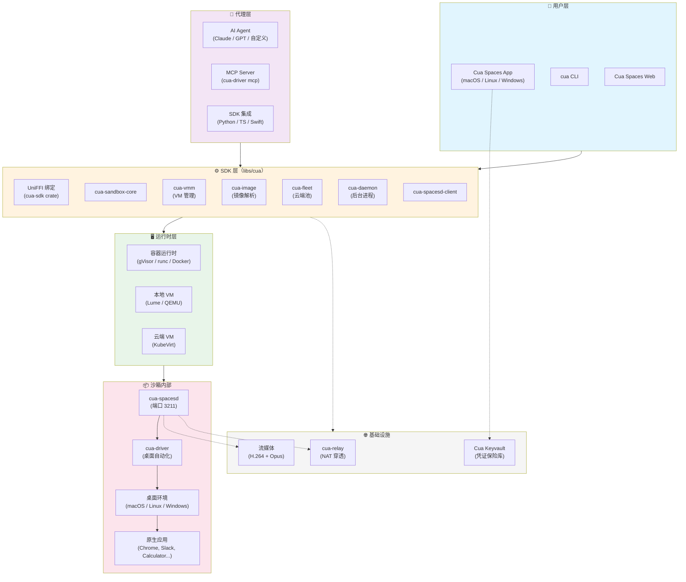
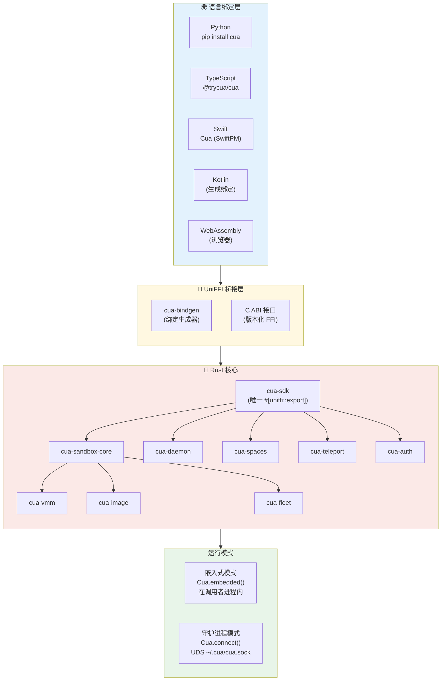
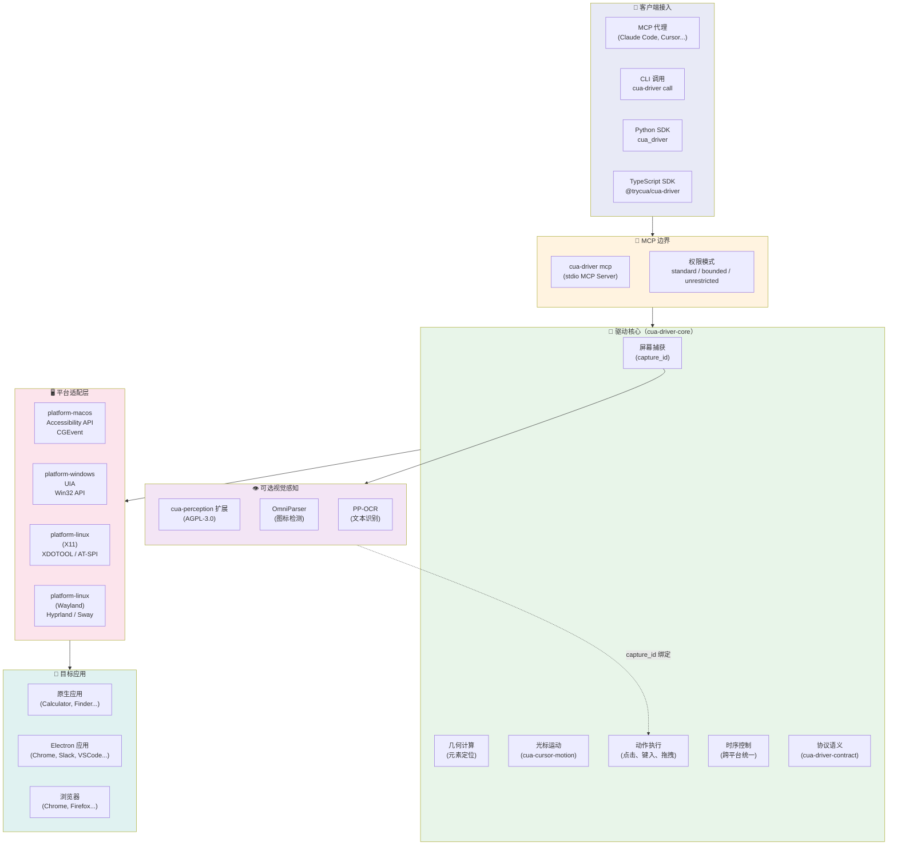
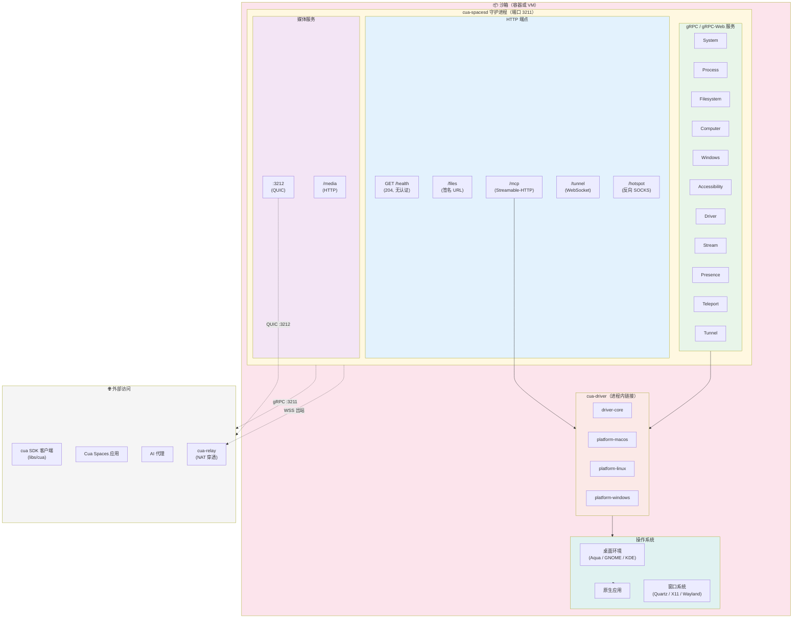
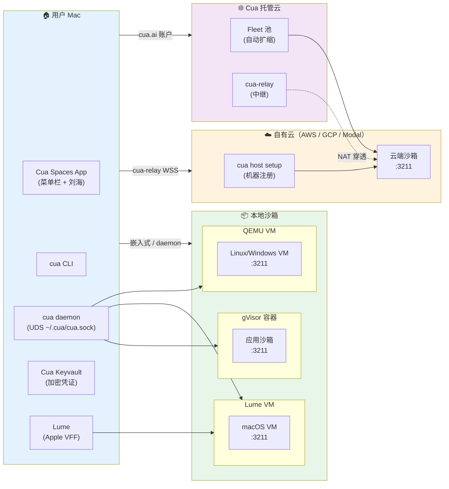
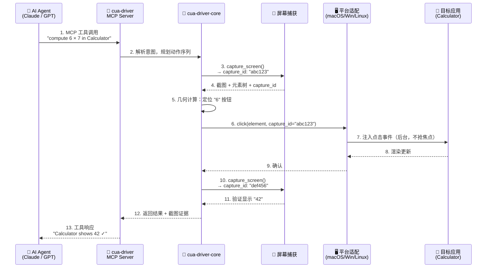
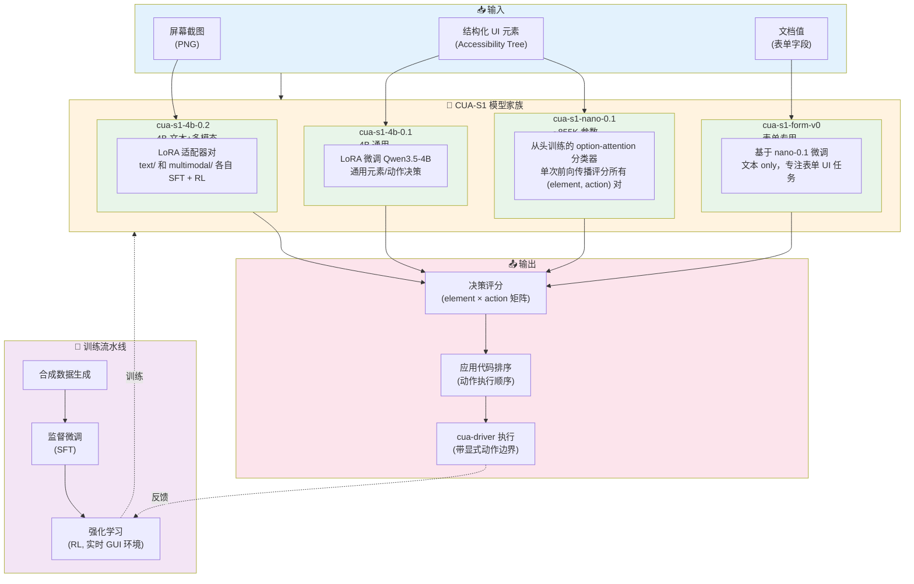
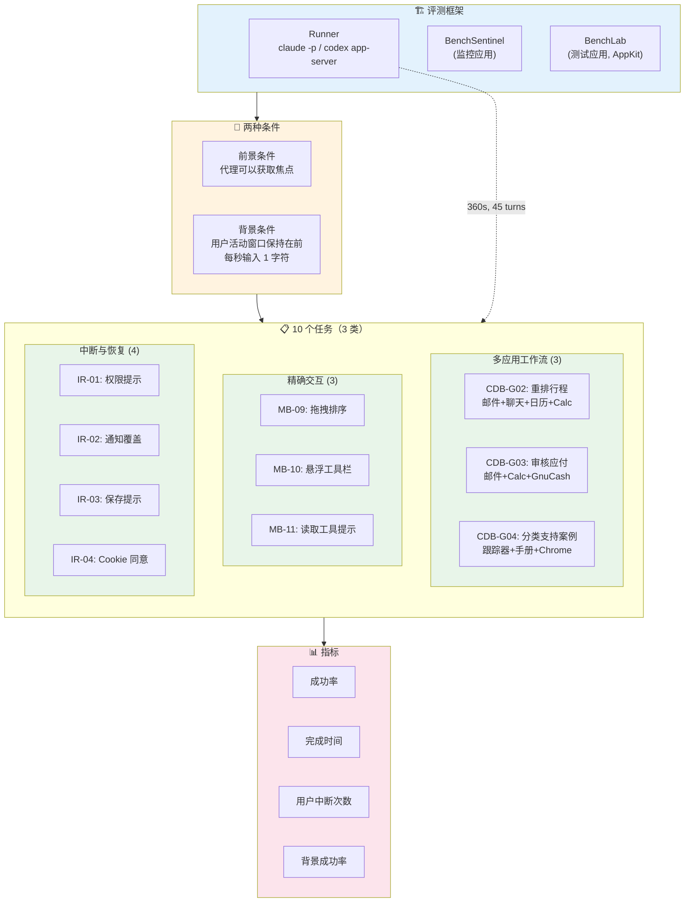

# Cua 项目分析报告

> 分析日期：2026-10-18
> 项目地址：https://github.com/trycua/cua
> 官方网站：https://cua.ai

---

## 目录

- [1. 项目概述](#1-项目概述)
  - [1.1 核心价值主张](#11-核心价值主张)
- [2. 核心产品矩阵](#2-核心产品矩阵)
  - [2.1 Cua Spaces（桌面应用）](#21-cua-spaces桌面应用)
  - [2.2 Cua Driver（桌面自动化驱动）](#22-cua-driver桌面自动化驱动)
  - [2.3 Lume（本地虚拟机管理）](#23-lume本地虚拟机管理)
  - [2.4 CUA-S1（专用决策模型）](#24-cua-s1专用决策模型)
  - [2.5 Cua Bench（基准测试平台）](#25-cua-bench基准测试平台)
- [3. 技术架构](#3-技术架构)
  - [3.1 单仓库结构](#31-单仓库结构)
  - [3.2 核心 SDK 架构](#32-核心-sdk-架构)
  - [3.3 语言栈分布](#33-语言栈分布)
  - [3.4 关键 Rust Crates](#34-关键-rust-crates)
  - [3.5 架构图与解析](#35-架构图与解析)
    - [图 1：总体系统架构](#图-1总体系统架构)
    - [图 2：SDK 多语言绑定架构](#图-2sdk-多语言绑定架构)
    - [图 3：Cua Driver 跨平台架构](#图-3cua-driver-跨平台架构)
    - [图 4：沙箱内部架构（cua-spacesd）](#图-4沙箱内部架构cua-spacesd)
    - [图 5：部署拓扑图](#图-5部署拓扑图)
    - [图 6：代理-桌面交互数据流](#图-6代理-桌面交互数据流)
    - [图 7：CUA-S1 模型流水线](#图-7cua-s1-模型流水线)
    - [图 8：Cua Driver Bench v2 评估架构](#图-8cua-driver-bench-v2-评估架构)
- [4. 多语言 SDK 支持](#4-多语言-sdk-支持)
  - [4.1 Python SDK](#41-python-sdk)
  - [4.2 TypeScript SDK](#42-typescript-sdk)
  - [4.3 Swift SDK](#43-swift-sdk)
  - [4.4 Kotlin SDK](#44-kotlin-sdk)
- [5. 构建与开发](#5-构建与开发)
  - [5.1 工具链要求](#51-工具链要求)
  - [5.2 开发环境搭建](#52-开发环境搭建)
  - [5.3 CI/CD 流水线](#53-cicd-流水线)
- [6. 测试策略](#6-测试策略)
  - [6.1 测试层级](#61-测试层级)
  - [6.2 测试原则](#62-测试原则)
  - [6.3 跨平台桌面 E2E](#63-跨平台桌面-e2e)
- [7. 许可证模型](#7-许可证模型)
  - [7.1 双许可证策略](#71-双许可证策略)
  - [7.2 FSL-1.1-MIT 关键条款](#72-fsl-11-mit-关键条款)
- [8. 已弃用组件](#8-已弃用组件)
- [9. 关键特性深度解析](#9-关键特性深度解析)
  - [9.1 Teleport（应用传送）](#91-teleport应用传送)
  - [9.2 cua-spacesd 守护进程](#92-cua-spacesd-守护进程)
  - [9.3 Cua Driver 后台执行](#93-cua-driver-后台执行)
- [10. 云和分布式架构](#10-云和分布式架构)
  - [10.1 部署选项](#101-部署选项)
  - [10.2 cua-relay（中继）](#102-cua-relay中继)
  - [10.3 Fleet SDK](#103-fleet-sdk)
- [11. 示例和用例](#11-示例和用例)
  - [11.1 官方示例](#111-官方示例)
  - [11.2 典型使用场景](#112-典型使用场景)
- [12. 社区与生态](#12-社区与生态)
  - [12.1 资源链接](#121-资源链接)
  - [12.2 贡献流程](#122-贡献流程)
  - [12.3 RFC 流程](#123-rfc-流程)
- [13. 竞争优势与差异化](#13-竞争优势与差异化)
  - [13.1 与竞品对比](#131-与竞品对比)
  - [13.2 技术护城河](#132-技术护城河)
- [14. 潜在风险与挑战](#14-潜在风险与挑战)
  - [14.1 技术风险](#141-技术风险)
  - [14.2 生态风险](#142-生态风险)
  - [14.3 竞争风险](#143-竞争风险)
- [15. 总结与建议](#15-总结与建议)
  - [15.1 项目成熟度评估](#151-项目成熟度评估)
  - [15.2 适用场景](#152-适用场景)
  - [15.3 学习路径建议](#153-学习路径建议)
- [附录 A：关键文件索引](#附录-a关键文件索引)
- [附录 B：常用命令速查](#附录-b常用命令速查)

---

## 1. 项目概述

**Cua (Computer Use Agent)** 是一个开源的 AI 代理计算机使用平台，其核心使命是 **"Give AI agents computers they can use"**（让 AI 代理拥有可用的计算机）。

该项目由 **Cua AI, Inc.** 开发和维护，采用**多语言单仓库（monorepo）**架构，涵盖了从底层虚拟机管理、桌面自动化驱动、到上层应用和基准测试的完整技术栈。

### 1.1 核心价值主张

- **为 AI 代理提供完整桌面环境**：macOS、Linux、Windows 虚拟机/容器
- **跨平台桌面自动化**：无需抢夺用户焦点即可操控原生应用
- **自托管优先**：支持本地机器、自有服务器和主流云平台（AWS、GCP、Modal）
- **人机协作**：用户和代理可在同一桌面同时工作，各有独立光标
- ** Bring Your Own Agent/Model**：支持任意 AI 代理和大语言模型接入

---

## 2. 核心产品矩阵

### 2.1 Cua Spaces（桌面应用）

**定位**：为 AI 代理提供完整桌面环境的主产品

| 特性 | 描述 |
|------|------|
| 平台支持 | macOS 26+（原生），Linux 和 Windows（Tauri/Electron） |
| 虚拟化 | macOS VM（Apple Virtualization.Framework）、Linux/Omarchy 镜像 |
| 部署位置 | 本地 Mac、自有机器、自有云账户（AWS/GCP/Modal） |
| 界面入口 | 菜单栏和刘海（Notch）集成 |

**关键创新**：

- **Teleport（传送）**：将已登录的应用（Chrome、Slack 等）移入 Space，会话保持登录状态。凭证通过 Cua Keyvault 加密存储在本地 Mac
- **Multiplayer（多人协作）**：用户和代理在同一桌面各自拥有独立光标，可随时介入或退出
- **Agent-ready images**：镜像内置 cua-spacesd 守护进程，代理启动即可获得进程、文件、截图、输入等能力

**定价**：
- 个人版：免费
- Pro：$18/月
- Teams：$30/座/月

### 2.2 Cua Driver（桌面自动化驱动）

**定位**：AI 代理的桌面自动化核心引擎，支持 macOS、Windows、Linux

| 特性 | 描述 |
|------|------|
| 通信协议 | MCP (Model Context Protocol) over stdio |
| 集成方式 | CLI、MCP Server、Python SDK、TypeScript SDK |
| 后台执行 | 支持在不抢夺焦点/光标的情况下操作应用（需应用和平台支持） |
| 视觉感知 | 可选 `cua-perception` 扩展（OmniParser + PP-OCR） |

**架构特点**：

- 跨平台行为统一：共享状态、几何、时序、协议语义在公共 crate 中实现，各平台适配器保持轻薄
- 输入安全：所有输入通过 cua-driver 传递，驱动本身不直接注入输入
- 权限模式：`standard`（默认，无提示）、`bounded`（受限清单）、`unrestricted`（需显式授权）

**平台支持层级**：

| 平台 | 状态 | 备注 |
|------|------|------|
| macOS | 完全支持 | Accessibility + Screen Recording 权限 |
| Windows | 完全支持 | 需要控制台或 RDP 会话 |
| Linux X11 | 完全支持 | Sway 和嵌套合成器 |
| Linux Wayland | 部分支持 | GNOME/KDE 需图形登录 |

### 2.3 Lume（本地虚拟机管理）

**定位**：Apple Silicon 上的 macOS/Linux 本地虚拟机管理工具

| 特性 | 描述 |
|------|------|
| 底层技术 | Apple Virtualization.Framework |
| 支持系统 | macOS Tahoe、macOS Sequoia、Linux |
| 自动化设置 | 无 GUI 离线无人值守安装 |
| SSH 默认可用 | 用户名/密码：`lume`/`lume` |

### 2.4 CUA-S1（专用决策模型）

**定位**：小型、专用的 "System 1" 计算机使用决策模型家族

> "System 1" 是工程类比，指快速、有界的决策（如选择字段值、判断是否跳过元素），不是通用规划/推理的替代。

| 模型 | 类型 | 描述 |
|------|------|------|
| `cua-s1-form-v0` | 微调文本模型 | 基于 `cua-s1-nano-0.1`，专注于表单类 UI 任务 |
| `cua-s1-nano-0.1` | 从头训练 | ~855K 参数，option-attention 分类器，单次前向传播评分 |
| `cua-s1-4b-0.1` | LoRA 微调 | 基于 Qwen3.5-4B，通用元素/动作决策 |
| `cua-s1-4b-0.2` | LoRA 适配器对 | 基于 Qwen3.5-4B，文本+多模态，各自有 SFT 和 RL 阶段 |

**研究重点**：表单场景——从结构化界面元素和文档值中做评分决策，而非逐 token 生成。

### 2.5 Cua Bench（基准测试平台）

**定位**：构建计算机使用任务、评估代理、导出训练轨迹

| 特性 | 描述 |
|------|------|
| 任务集注册表 | `cua.ai/cuabench/registry`，版本固定到 git commit |
| 执行方式 | 本地沙箱或云端，支持 gVisor/runc/QEMU/Lume/KubeVirt |
| 输出格式 | ATIF-v1.8 轨迹（Harbor 格式），含截图 |
| 指标 | pass@k、每阶段计时、异常信息 |

**Cua Driver Bench（Bench v2）**：

- 当前仅 macOS 26
- 10 个任务分 3 类：多应用工作流、精确交互、中断与恢复
- 预注册方法，日期化修订
- 前景/背景两种条件测试
- 使用 Claude Code + Sonnet 5.5 和 Codex CLI + GPT-6.1 Sol 作为代理/模型

---

## 3. 技术架构

### 3.1 单仓库结构

```
cua-main/
├── apps/                    # 应用层
│   ├── cua-spaces/          # Tauri 桌面应用（Linux/Windows）
│   ├── cua-spaces-desktop/  # Electron 桌面应用
│   ├── cua-spaces-macos/    # SwiftUI macOS 原生应用
│   └── cua-spaces-web/      # Web UI（共享前端）
│
├── libs/                    # 核心库
│   ├── cua/                 # cua SDK（Rust 核心 + 多语言绑定）
│   ├── cua-driver/          # 桌面自动化驱动（Rust + 平台适配）
│   ├── cua-spacesd/         # 沙箱内守护进程
│   ├── cua-s1/              # CUA-S1 模型代码
│   ├── cua-bench/           # 基准测试框架
│   ├── cua-bench-rl/        # RL 环境
│   ├── cua-bench-s1/        # S1 评估
│   ├── lume/                # macOS/Linux VM 管理（Swift）
│   ├── python/              # Python SDK 集合
│   ├── typescript/          # TypeScript SDK 集合
│   ├── fleet/               # Fleet SDK（只读镜像）
│   ├── images/              # 沙箱镜像定义
│   ├── kasm/                # Kasm VNC 集成
│   ├── lumier/              # Docker 兼容的 Lume 接口
│   ├── qemu-docker/         # QEMU Docker 镜像
│   ├── xfce/                # XFCE 桌面配置
│   └── xfce-cua/            # XFCE Cua 定制
│
├── benchmarks/              # 基准测试
│   └── cua-driver-bench/    # Cua Driver 评测
│
├── examples/                # 示例
│   ├── agents-in-sandboxes/ # 沙箱中运行代理
│   └── streaming/           # 流式传输示例（多语言）
│
├── samples/                 # 完整示例项目
│   ├── cua-bots-macos/      # macOS Cua Bots
│   ├── cua-bots-ios/        # iOS Cua Bots
│   ├── infinite-canvas-swift/
│   └── openkoalabot-example-*/
│
├── docs/                    # 文档站点（Fumadocs）
├── scripts/                 # 构建/CI 脚本
├── tests/                   # 跨组件 E2E 测试
├── rfcs/                    # RFC 文档
├── infra/                   # 基础设施
├── clusters/                # 集群配置
└── blog/                    # 博客文章
```

### 3.2 核心 SDK 架构

```
 Python / Node / Swift / Kotlin / wasm
        |  UniFFI (cua-sdk 是唯一的 #[uniffi::export] crate)
 +------+------------------------------------------------------------+
 | cua-sdk -- cua-sandbox-core -- cua-vmm / cua-image / cua-fleet     |
 |    |              +-- cua-spacesd-client (client) -- cua-proto     |
 |    +-- cua-spaces, cua-teleport, cua-daemon (UDS)                  |
 +------------------------------+-------------------------------------+
          gRPC / gRPC-Web on :3211, media on /media or QUIC :3212
 +------------------------------+-------------------------------------+
 | cua-spacesd (libs/cua-spacesd): 仅在沙箱内运行                  |
 | 依赖 cua-proto 和 cua-media-* crates，输入通过 cua-driver         |
 +---------------------------------------------------------------------+
```

**关键设计原则**：

1. **沙箱与守护进程解耦**：沙箱生命周期和就绪性不依赖 cua-spacesd；Spaces 特性（流、存在、传送等）才需要它
2. **客户端-服务端分离**：`libs/cua-spacesd` 仅在沙箱内运行；客户端代码在 `libs/cua`；驱动依赖 `libs/cua`，反向禁止
3. **Protobuf 合约**：`libs/cua/proto` 中的 `.proto` 文件是合约，变更必须是附加的并通过 `buf breaking`
4. **嵌入式或守护进程模式**：`Cua.embedded()` 在进程内运行一切；`Cua.connect()` 与 `cua daemon` 通信（UDS `~/.cua/cua.sock`）

### 3.3 语言栈分布

| 语言 | 文件数 | 主要用途 |
|------|--------|----------|
| Rust | ~1,730 | 核心 SDK、CLI、守护进程、驱动、流媒体编解码 |
| Python | ~1,348 | SDK 绑定、代理框架、基准测试、模型代码 |
| TypeScript | ~1,187 | Web UI、SDK 绑定、文档站点、CuaBot（已弃用） |
| Swift | ~577 | macOS/iOS 应用、Lume VM 管理、Spaces 原生组件 |

### 3.4 关键 Rust Crates

**cua SDK（44 个 crates）**：

| Crate | 职责 |
|-------|------|
| `cua-sdk` | 唯一 UniFFI 导出 crate |
| `cua-sandbox-core` | 沙箱核心逻辑 |
| `cua-vmm` | 虚拟机管理（lume/qemu） |
| `cua-image` | 镜像解析和选择 |
| `cua-fleet` | 云端 Fleet 集成 |
| `cua-daemon` | 后台守护进程 |
| `cua-cli` | 命令行工具 |
| `cua-proto` | Protobuf 生成的代码 |
| `cua-spacesd-client` | Spaces 守护进程客户端 |
| `cua-teleport` | 应用传送功能 |
| `cua-keyvault` | 凭证保险库 |
| `cua-media-*` | 流媒体协议、传输、编解码、客户端 |
| `cua-auth` | 认证 |
| `cua-telemetry` | 遥测 |

**cua-driver（16 个 crates）**：

| Crate | 职责 |
|-------|------|
| `cua-driver` | 顶层 crate |
| `cua-driver-core` | 核心逻辑 |
| `cua-driver-contract` | 合约定义 |
| `cua-driver-sdk` | SDK |
| `cua-driver-e2e` | E2E 测试 |
| `cua-driver-testkit` | 测试工具包 |
| `cua-driver-uia` | UI 自动化 |
| `cua-driver-bindgen` | 绑定生成 |
| `platform-macos` | macOS 平台适配 |
| `platform-windows` | Windows 平台适配 |
| `platform-linux` | Linux 平台适配 |
| `cua-cursor-motion` | 光标运动 |
| `cua-perception` | 视觉感知（OmniParser） |
| `cursor-overlay` | 光标叠加层 |
| `cursor-theme-cli` | 光标主题 CLI |
| `pip-preview` | Pip 预览 |

### 3.5 架构图与解析

以下架构图使用 Mermaid 语法描述。支持 Mermaid 渲染的阅读器（GitHub、GitLab、Notion、Typora 等）会将其显示为可视化图表；不支持的阅读器将以代码块形式展示。

---

#### 图 1：总体系统架构



**解析**：

这是整个 Cua 系统的**全景视图**，从上到下分为 6 个层次：

1. **用户层**（蓝色）：用户直接交互的入口。Cua Spaces 桌面应用（SwiftUI/Electron/Tauri）提供菜单栏和刘海集成；CLI 提供命令行控制；Web UI 提供浏览器访问。

2. **代理层**（紫色）：AI 代理的接入点。代理可以通过 MCP 协议（cua-driver mcp 作为 stdio 服务端）直接连接，也可以通过 Python/TypeScript/Swift SDK 编程接入。这一层体现了 "Bring Your Own Agent" 的设计理念。

3. **SDK 层**（橙色）：核心中枢。`cua-sdk` 是唯一的 UniFFI 导出 crate，为所有语言提供统一接口。`cua-sandbox-core` 封装了沙箱生命周期管理；`cua-vmm` 负责虚拟机管理（调用 Lume 或 QEMU）；`cua-image` 解析镜像引用；`cua-fleet` 管理云端资源池。`cua-daemon` 提供跨进程共享的后台服务。

4. **运行时层**（绿色）：实际的隔离环境。支持 gVisor（安全容器）、runc（普通容器）、Lume（Apple VMM）、QEMU（通用虚拟化）、KubeVirt（云端 VM）。`auto` 模式根据操作系统和任务自动选择。

5. **沙箱内部**（粉色）：运行在隔离环境中的组件。`cua-spacesd` 是核心守护进程，监听端口 3211，提供 gRPC 服务；`cua-driver` 负责实际的桌面自动化操作；桌面环境和原生应用是最终的操作目标。

6. **基础设施**（灰色）：支撑服务。`cua-relay` 实现 NAT 穿透（机器无需公网 IP）；`Cua Keyvault` 加密存储凭证；流媒体系统提供低延迟的视频（H.264）和音频（Opus）传输。

**关键设计约束**：
- `cua-spacesd` 仅在沙箱内运行（服务端），客户端代码在 `libs/cua`
- `cua-driver` 被 `cua-spacesd` 链接使用，反向依赖禁止
- 所有输入通过 `cua-driver` 传递，spacesd 自身不注入输入

---

#### 图 2：SDK 多语言绑定架构



**解析**：

这张图展示了 Cua 如何实现**一套核心、多语言可用**的架构目标：

**UniFFI 桥接机制**：

Mozilla 的 [UniFFI](https://mozilla.github.io/uniffi-rs/) 是核心绑定技术。`cua-sdk` crate 是整个项目中**唯一**标记 `#[uniffi::export]` 的 crate，这意味着只有它对外暴露 API。`cua-bindgen` 根据 Rust 接口定义自动生成 Python、TypeScript、Swift、Kotlin 的绑定代码和 C ABI 桥接层。

这种设计的关键优势：
- **单一 API 源**：避免多份实现不一致
- **类型安全**：编译期检查跨语言类型映射
- **版本化 FFI**：C ABI 层有版本号，支持向前兼容
- **漂移检测**：CI 中 `node scripts/generate-uniffi-bindings.mjs --check` 检测绑定是否过期

**两种运行模式**：

- **嵌入式模式**（`Cua.embedded()`）：所有 Rust 代码直接编译到调用者进程中。适合应用集成（如 Cua Spaces 桌面应用内嵌 SDK）。零 IPC 开销，但进程退出即销毁。

- **守护进程模式**（`Cua.connect()`）：通过 Unix Domain Socket（`~/.cua/cua.sock`，权限 0600）与 `cua daemon` 通信。多个进程可以共享同一个 daemon，从而共享沙箱、环境连接、隧道、流和凭证。适合 CLI 和多代理场景。

**Rust 核心 crates 的职责分层**：

- `cua-sandbox-core`：沙箱生命周期（创建、销毁、就绪探测）——不假设任何特定的沙箱内服务
- `cua-vmm`：虚拟机管理——macOS 上调 Lume，Linux 上拉取 QEMU
- `cua-image`：镜像解析——`Image.linux()` 解析为 `ghcr.io/trycua/linux:24.04`
- `cua-fleet`：云端池管理——声明式池配置、自动扩缩容
- `cua-spaces`：Spaces 特性——流、存在、传送、文件发送
- `cua-teleport`：应用传送——会话加密迁移
- `cua-auth`：认证——cua.ai 账户集成

---

#### 图 3：Cua Driver 跨平台架构



**解析**：

这张图展示了 Cua Driver 作为**跨平台桌面自动化引擎**的内部结构：

**客户端接入（多入口、同一运行时）**：

代理可以通过 4 种方式连接到 Driver，但底层都调用相同的原生运行时：

- **MCP over stdio**：MCP 兼容代理（Claude Code、Cursor 等）直接连接 `cua-driver mcp`。这是最推荐的集成方式。
- **CLI 调用**：Shell 脚本和自动化工具使用 `cua-driver call` 执行单个操作。
- **Python/TypeScript SDK**：应用内嵌入，通过 UniFFI 绑定调用同一原生运行时。**注意**：语言包是给客户端应用的，不包含 MCP 门面。

**权限模式（安全边界）**：

- `standard`：默认，无提示，正常自动化
- `bounded`：只允许经过审查的工具和资源清单
- `unrestricted`：需要 `--dangerously-bypass-approvals` 显式授权

权限在进程启动时固定，不属于单次调用。

**驱动核心（跨平台合约）**：

`cua-driver-core` 实现了所有平台共享的行为合约：

- **屏幕捕获**：每次捕获生成唯一的 `capture_id`，后续动作必须携带相同的 ID。这是安全审计链的基础。
- **几何计算**：元素定位、坐标变换——在所有平台上行为一致
- **光标运动**：`cua-cursor-motion` crate 实现自然的光标轨迹
- **时序控制**：动画等待、延迟策略——跨平台统一
- **协议语义**：`cua-driver-contract` 定义了操作的含义（"点击这个元素"意味着什么）

**平台适配层（轻薄适配器）**：

每个平台适配器只实现平台特定的部分，共享逻辑在上层：

| 平台 | 技术 | 特点 |
|------|------|------|
| macOS | Accessibility API + CGEvent | 后台执行支持最好，不抢焦点 |
| Windows | UIA + Win32 API | 需要控制台或 RDP 会话 |
| Linux X11 | XDOTOOL / AT-SPI | Sway 和嵌套合成器测试 |
| Linux Wayland | Hyprland / Sway 协议 | 部分支持，取决于合成器 |

**可选视觉感知**：

`cua-perception` 扩展（AGPL-3.0 许可）提供截图分析能力：

- **OmniParser**：图标和 UI 元素检测（AGPL-3.0-only）
- **PP-OCR**：文本识别（Apache-2.0）

关键约束：从区域推导的像素点击必须携带与观察相同的 `capture_id`，确保动作和观察的因果链。

---

#### 图 4：沙箱内部架构（cua-spacesd）



**解析**：

这张图展示了**沙箱内部的详细结构**——即 AI 代理实际"看到"和"操作"的环境：

**cua-spacesd 守护进程**是整个沙箱的神经中枢，一个二进制文件在同一端口（3211）上提供多种协议：

**gRPC 服务族（11 个服务）**：

| 服务 | 职责 |
|------|------|
| `System` | 系统信息、能力查询（`GetCapabilities`）、初始化（`Init`） |
| `Process` | 进程管理——启动、停止、列出 |
| `Filesystem` | 文件操作——读、写、列出、监视 |
| `Computer` | 计算机信息——OS 版本、架构、资源 |
| `Windows` | 窗口管理——列出、聚焦、调整大小 |
| `Accessibility` | 辅助功能树——元素查询、操作 |
| `Driver` | 桌面自动化——输入注入（委托给 cua-driver） |
| `Stream` | 流媒体——视频/音频流会话管理 |
| `Presence` | 存在感知——光标位置、用户在线状态 |
| `Teleport` | 应用传送——会话迁移 |
| `Tunnel` | 隧道——端口转发、SOCKS 代理 |

**HTTP 端点**：

- `GET /health`：健康检查，无认证，返回 204。用于负载均衡器和就绪探测。
- `/files`：文件上传/下载，使用 HMAC 签名 URL，强制过期时间。
- `/mcp`：Streamable-HTTP MCP 协议，让代理通过 HTTP 连接 cua-driver 工具注册表。
- `/tunnel`：WebSocket 隧道，用于端口转发。
- `/hotspot`：反向 SOCKS 出口，让沙箱可以访问外部网络。

**媒体服务**：

视频（H.264）和音频（Opus）有专用通道，不在 gRPC 端口上：
- HTTP `/media`：兼容防火墙的媒体传输
- QUIC `:3212`：低延迟 UDP 媒体传输（Media Wire v2 协议）

**安全模型**：

- **Token 认证**：非回环绑定必须提供 token（`authorization: Bearer <token>`）
- **常数时间比较**：防止时序攻击
- **短期票据**：媒体、隧道、热点使用基于 token 派生的短期票据，token 轮换即撤销
- **签名 URL**：`/files` 使用 HMAC 签名，带强制过期

**cua-driver 进程内链接**：

`cua-spacesd` 在编译时链接 `cua-driver-core` 和平台适配器。这意味着桌面自动化操作在守护进程内直接执行，无额外 IPC 开销。但 Driver 不自行决定何时注入输入——所有输入由 spacesd 通过 `Driver` 服务触发。

---

#### 图 5：部署拓扑图



**解析**：

这张图展示了 Cua 支持的**三种部署拓扑**及其关系：

**本地部署（左侧）**：

一切运行在用户的 Mac 上。Cua Spaces App 提供图形界面，`cua daemon` 作为后台进程通过 Unix Domain Socket 与 CLI 和 SDK 通信。Lume 使用 Apple Virtualization.Framework 创建 macOS VM。

支持的本地运行时：

| 运行时 | 类型 | 适用场景 |
|--------|------|----------|
| gVisor | 安全容器 | Linux 沙箱，内核隔离 |
| runc | 普通容器 | 信任度较高的 Linux 工作负载 |
| Lume | macOS VM | 需要完整 macOS 环境 |
| QEMU | 通用 VM | Windows、Android、其他 Linux |

`cua runtime doctor|setup` 命令可以检测并安装缺失的运行时。

**自有云部署（中间）**：

用户在自己的云账户（AWS、GCP、Modal）中运行 `cua host setup`，将该机器注册到 cua.ai 中继。机器通过一条出站 WSS 连接发布自己，无需入站端口或端口转发。

**Cua 托管云（右侧）**：

Cua AI 运营的托管服务。Fleet 池提供声明式沙箱管理（类似 Kubernetes Deployment），自动扩缩容，预热副本（`--warm`），和 claim TTL（崩溃后保留时间）。

**混合使用**：

同一条 `cua` 命令可以在三种拓扑间切换：

```bash
cua sb create ubuntu --name dev          # 本地 gVisor
cua sb create ubuntu --name dev --on cloud  # Cua 托管云
```

SDK 层面完全透明——只有 `on` 参数改变。

---

#### 图 6：代理-桌面交互数据流



**解析**：

这条序列图展示了**从代理意图到桌面操作的完整数据流**——以 "在 Calculator 中计算 6 × 7" 为例：

**步骤 1-2：意图解析**

代理通过 MCP 发送高层指令。cua-driver MCP 服务端将自然语言意图分解为具体的动作序列（打开 Calculator → 点击 6 → 点击 × → 点击 7 → 验证结果）。

**步骤 3-4：屏幕捕获**

每次操作前先截屏。`capture_screen()` 返回：
- 截图图片
- UI 元素树（通过 Accessibility API）
- 唯一的 `capture_id`（如 "abc123"）

这个 ID 是安全审计链的关键——后续基于这张截图的每个动作都必须携带相同的 ID。

**步骤 5：几何计算**

`cua-driver-core` 根据元素树计算目标按钮的精确坐标。这一步在所有平台上行为一致。

**步骤 6-9：动作执行**

`click(element, capture_id)` 调用链：
1. Core 委托给平台适配器
2. 平台适配器使用系统 API 注入事件（macOS: CGEvent，Windows: UIA/Win32，Linux: XDOTOOL/AT-SPI）
3. 关键：**后台执行**——不抢夺前台窗口的焦点（需要应用和平台支持）
4. 目标应用渲染更新

**步骤 10-13：验证与返回**

操作完成后再次截屏，验证 Calculator 显示 "42"。结果（包括截图证据）返回给代理。代理据此判断任务是否完成。

**capture_id 的意义**：

如果代理试图使用一个过期的 capture_id（比如截图已经改变），Driver 会拒绝操作。这防止了基于过时信息的错误操作。

---

#### 图 7：CUA-S1 模型流水线



**解析**：

这张图展示了 CUA-S1 研究项目的**模型家族和训练流水线**：

**"System 1" 概念**：

借用 Daniel Kahneman 的认知科学术语，"System 1" 指快速、直觉式的决策——与"System 2"的慢速推理相对。在 Cua 的语境中，S1 模型处理的是**小而快的 UI 决策**：

- 这个字段应该填什么值？
- 是否应该跳过这个元素？
- 这个按钮应该点击吗？

**模型家族**：

| 模型 | 规模 | 特点 | 适用场景 |
|------|------|------|----------|
| **nano-0.1** | ~855K | 从头训练，option-attention 分类器 | 研究基线、嵌入式部署 |
| **form-v0** | ~855K | nano 微调，文本 only | 表单填写场景 |
| **4b-0.1** | 4B (LoRA) | Qwen3.5-4B 基础，文本 LoRA | 通用 UI 决策 |
| **4b-0.2** | 4B (LoRA×2) | 文本 + 多模态适配器对 | 需要视觉理解的场景 |

4b-0.2 的特殊之处：它有两个独立的 LoRA 适配器（`text/` 和 `multimodal/`），各自经历了 SFT → RL 两个训练阶段。这意味着文本推理和视觉理解可以独立优化。

**训练流水线**：

1. **合成数据生成**：从真实 UI 环境自动生成训练样本
2. **监督微调（SFT）**：在标注数据上训练基础能力
3. **强化学习（RL）**：在**实时 GUI 环境**中训练——模型通过与真实桌面交互来优化决策。这是区别于纯离线训练的关键。

**决策-执行分离**：

S1 模型只负责**评分决策**（哪些元素值得操作、应该执行什么动作），不负责执行。执行顺序由应用代码控制，实际操作由 cua-driver 完成（带显式动作边界）。

这种分离的好处：
- 模型可以专注于它擅长的（快速评分）
- 执行逻辑可以独立测试和验证
- 安全边界清晰（cua-driver 的 capture_id 机制仍然生效）

---

#### 图 8：Cua Driver Bench v2 评估架构



**解析**：

这张图展示了 Cua Driver Bench v2 的**评估框架**——一个测量"计算机使用工具层让代理完成真实桌面工作的能力"的基准测试系统：

**核心设计原则**：

在同一个 agent harness 中，代理、模型、提示和限制对所有 setup 完全相同——**只有计算机使用工具层变化**。这意味着 Bench 测量的是工具层的能力差异，而不是模型或代理的差异。

**两种条件**：

- **前景条件**：代理可以获取焦点——测试传统的前台自动化能力
- **背景条件**：一个"用户活动"窗口保持在前台，每秒输入一个字符——测试 Cua Driver 的后台执行能力。这是 Cua 的核心差异化特性。

**10 个任务**：

| 类别 | 测试重点 | 示例 |
|------|----------|------|
| 多应用工作流 | 跨应用信息整合和决策 | 邮件+日历+Calc 重排行程 |
| 精确交互 | 精细的 UI 操作 | 拖拽排序、悬浮工具栏 |
| 中断与恢复 | 面对弹窗/覆盖的鲁棒性 | 权限提示、Cookie 同意覆盖 |

**限制**：

- 每个 trial 最多 360 秒、45 个 turn
- 当前仅 macOS 26
- 预注册方法，修订版有时间戳

---

---

## 4. 多语言 SDK 支持

### 4.1 Python SDK

| 包名 | 路径 | 描述 |
|------|------|------|
| `cua` | `libs/cua/python` | 核心 SDK（UniFFI 绑定） |
| `cua-sandbox` | `libs/python/cua-sandbox` | 高层 `Sandbox`/`Image`/`Pool` API |
| `cua-core` | `libs/python/core` | 核心 Python 工具 |
| `cua-agent` | `libs/python/agent` | **已弃用** — 使用 Cua Driver MCP |
| `cua-som` | `libs/python/som` | **已弃用** — 使用 Cua Driver |
| `cua-bench` | `libs/cua-bench` | 基准测试框架 |
| `cua-s1` | `libs/cua-s1/python` | CUA-S1 模型代码 |

**安装**：

```bash
pip install cua                    # 核心 SDK
pip install cua-sandbox            # 高层沙箱 API
uv tool install 'cua-bench[browser]' # 基准测试
```

### 4.2 TypeScript SDK

| 包名 | 路径 | 描述 |
|------|------|------|
| `@trycua/cua` | `libs/typescript/core` | 核心 SDK |
| `@trycua/cua/spaces` | 同上 | Spaces 扩展 |
| `@trycua/agent` | `libs/typescript/agent` | 代理框架 |
| `@trycua/fleet` | `libs/typescript/fleet` | Fleet 客户端 |
| `@trycua/cursor-motion` | `libs/typescript/cursor-motion` | 光标运动 |

### 4.3 Swift SDK

| 包名 | 路径 | 描述 |
|------|------|------|
| `Cua` | `libs/cua/swift` | 核心 SDK（SwiftPM, XCFramework） |
| `CuaSpacesFFI` | `libs/spaces-sdk-swift` | Spaces 应用导出 |
| `CuaSpacesTeleport` | 同上 | 传送选择器 |
| `CuaSpacesStreaming` | 同上 | 流式客户端 |
| `CuaSpacesNotchUI` | `libs/spaces-notch-swift` | 刘海视图 |
| `Lume` | `libs/lume` | VM 管理 CLI |

### 4.4 Kotlin SDK

生成的 UniFFI 绑定，路径在 `libs/cua/kotlin`。

---

## 5. 构建与开发

### 5.1 工具链要求

| 组件 | 工具链 |
|------|--------|
| Python 包 | Python 3.12+, uv |
| TypeScript/文档 | Node.js, pnpm |
| cua SDK / cua-spacesd | Rust (rust-toolchain.toml 固定版本), protoc, buf |
| cua-driver | Rust + 平台 SDK; Linux 上需要 Nix |
| Lume | macOS, Swift, Xcode CLT |
| 镜像 | Docker + 组件特定工具链 |

### 5.2 开发环境搭建

```bash
# 克隆
git clone https://github.com/trycua/cua.git
cd cua

# Python 开发工具
uv sync --group dev
uv run pre-commit install

# 格式化检查
pnpm install --frozen-lockfile
pnpm prettier:check

# Rust 测试
cd libs/cua
cargo test --locked -p cua-sdk -p cua-daemon -p cua-cli

# cua-driver 测试
cd libs/cua-driver/rust
cargo test --locked
```

### 5.3 CI/CD 流水线

项目使用 **GitHub Actions**，共有 **164 个工作流文件**，覆盖：

| 类别 | 工作流示例 |
|------|-----------|
| 持续集成 | `ci-test-python.yml`, `ci-cua-sdk.yml`, `ci-cua-driver-*.yml` |
| 持续部署 | `cd-cua-sdk.yml`, `cd-cua-driver.yml`, `cd-cua-spaces.yml`, `cd-container-*.yml` |
| 镜像构建 | `cd-image-linux.yml`, `cd-image-macos.yml`, `cd-image-windows.yml` |
| 基准测试 | `bench-streaming.yml` |
| 发布管理 | Release Please（多组件独立发布） |

**发布策略**：

- **Release Please** 管理多组件独立发布
- 各组件有自己的版本标签前缀（如 `cua-driver-rs-v*`、`cua-spaces-v*`）
- **不使用** GitHub 仓库级别的 "Latest" 徽章来判断组件发布状态
- Docker 镜像仍通过 Legacy `release-bump-version.yml` 工作流发布

---

## 6. 测试策略

### 6.1 测试层级

| 层级 | 描述 | 范围 |
|------|------|------|
| 单元测试 | 各 crate/package 内部 | `cargo test`, `pytest`, `vitest` |
| 合约测试 | Protobuf breaking/lint | `buf lint`, `buf breaking` |
| 绑定漂移测试 | UniFFI 绑定一致性 | `--check` 标志 |
| 集成测试 | 跨组件交互 | `tests/integration` |
| E2E 测试 | 完整场景 | `tests/e2e/cua-sdk`, `tests/e2e/local-runtimes` |
| 桌面 E2E | 真实桌面环境 | `cua-driver-e2e`，各平台 harness |

### 6.2 测试原则

1. **每个合约一个 owner 测试**：在能观察到它的最强边界处
2. **不添加测试专用开关**：通过公共接口或真实接缝测试
3. **`cargo test` 必须密封**：无真实输入、剪贴板、窗口、主机状态
4. **桌面测试隔离**：放在 `cua-driver-e2e` 或标记 `#[ignore]`
5. **负面测试**：断言确切的拒绝码或错误，不只是失败
6. **剪贴板需要显式授权**：`CUA_TEST_ALLOW_CLIPBOARD=1`

### 6.3 跨平台桌面 E2E

- macOS：Calculator、TextEdit（canonical）
- Windows：需要控制台或 RDP 会话
- Linux：Sway（CI）、GNOME/KDE（现有图形登录）
- 在实现稳定后、PR 就绪前的确切 SHA 上运行完整矩阵

---

## 7. 许可证模型

### 7.1 双许可证策略

| 组件 | 许可证 | 说明 |
|------|--------|------|
| 大部分仓库 | **MIT** | cua SDK、CLI、Cua Driver、Lume 等 |
| Cua Spaces | **FSL-1.1-MIT** | 源码可用，禁止竞争托管服务，2 年后转为 MIT |
| Cua Driver Bench | **FSL-1.1-MIT** | 2026-10-11 之前为 MIT |
| cua-perception 扩展 | **AGPL-3.0-only** | OmniParser 检测器，非 MIT |
| cua-som | **AGPL-3.0-or-later** | 可选包 |

### 7.2 FSL-1.1-MIT 关键条款

- 免费使用、自托管、构建
- **禁止**提供竞争性托管服务
- 每个版本在发布 2 年后自动转为 MIT
- MIT 部分不依赖 FSL 部分

---

## 8. 已弃用组件

| 包名 | 替代方案 | 备注 |
|------|----------|------|
| `cuabot` | Cua Driver 或 `cua` CLI | **有安全问题，停止使用并卸载** |
| `cua-computer` | `cua` SDK + Cua Driver | |
| `cua-computer-server` | cua-spacesd 或 Cua Driver | |
| `cua-agent` | Cua Driver MCP 或 `sandbox.agents()` | |
| `cua-som` | Cua Driver | |

---

## 9. 关键特性深度解析

### 9.1 Teleport（应用传送）

**工作原理**：

1. 用户在本地 Mac 上将应用（如 Chrome）"传送"到 Space
2. 应用会话通过 Cua Keyvault 加密存储
3. 会话仅在用户批准后到达 Space
4. 应用在新的 Space 中打开，保持登录状态

**技术实现**：

- `cua-teleport` crate：传送提供者和应用传送 UX
- `cua-teleport-bundle`：传送捆绑包格式
- `cua-keyvault`：凭证加密存储
- `cua-machine-seal`：端到端密钥密封

### 9.2 cua-spacesd 守护进程

**端口和服务**：

| 表面 | 描述 |
|------|------|
| gRPC/gRPC-Web :3211 | System, Process, Filesystem, Computer, Windows, Accessibility, Driver, Stream, Presence, Teleport, Tunnel 服务 |
| `GET /health` | 无认证，204 响应 |
| `/files` | 签名 URL 上传/下载（HMAC，强制过期） |
| `/mcp` | Streamable-HTTP MCP over cua-driver 工具注册表 |
| `/tunnel`, `/hotspot` | 端口转发和反向 SOCKS 出口（票据 WebSocket） |
| `/media`, QUIC :3212 | 视频（H.264）和音频（Opus） |

**安全模型**：

- 非回环绑定需要 token
- Token 比较使用常数时间
- 媒体、隧道、热点使用短期票据或签名 URL
- Token 轮换撤销所有活跃会话

### 9.3 Cua Driver 后台执行

**工作原理**：

- 通过辅助输入方法（非主光标/键盘）与应用交互
- 需要应用和平台支持（参见平台支持文档）
- 不抢夺前台窗口的焦点
- 允许多个代理会话并行工作

**验证方式**：

- 前景条件：代理可以获取焦点
- 背景条件："用户活动"窗口保持在前，每秒输入一个字符
- 测量：成功完成时间、用户中断次数

---

## 10. 云和分布式架构

### 10.1 部署选项

| 模式 | 描述 |
|------|------|
| 本地 | `cua sb create` — 本地 gVisor 容器或 VM |
| 自有云 | AWS、GCP、Modal — 通过 `cua host setup` |
| Cua 云 | 托管 Fleet 池 — `--on cloud` |

### 10.2 cua-relay（中继）

**用途**：让 NAT 后的机器无需入站端口即可被访问

```bash
CUA_ENV_TOKEN=... cua-spacesd join --relay wss://relay.example --relay-token ...
```

**客户端访问**：

```
https://<relay>/m/<machine-id>/
```

**账户模式**：

- 通过 cua.ai 账户认证机器和客户端
- 中继转发中继签名的主体断言
- 驱动根据主机策略检查（所有者、允许列表、停止共享）
- 环境 token 永不离开主机

### 10.3 Fleet SDK

**路径**：`libs/fleet`（只读镜像）

- 云端沙箱池管理
- 声明式池配置
- 自动扩缩容
- 健康检查和就绪探测

---

## 11. 示例和用例

### 11.1 官方示例

| 示例 | 描述 | 路径 |
|------|------|------|
| Agents in Sandboxes | 在沙箱中运行 AI 代理 | `examples/agents-in-sandboxes` |
| Streaming | 多语言流式传输示例 | `examples/streaming/{python,typescript,rust,swift,kotlin}` |
| Cua Bots | macOS/iOS 示例应用 | `samples/cua-bots-macos`, `samples/cua-bots-ios` |
| Infinite Canvas | Swift 无限画布 | `samples/infinite-canvas-swift` |
| OpenKoalaBot | 多平台示例 | `samples/openkoalabot-example-*` |

### 11.2 典型使用场景

**场景 1：本地开发沙箱**

```bash
cua sb create ubuntu --name dev
cua sb exec dev uname -a
cua sb screenshot dev
cua sb rm dev
```

**场景 2：Python SDK 编程**

```python
from cua_sandbox import Image, Sandbox

async with Sandbox.ephemeral(Image.linux(), local=True) as sb:
    print((await sb.shell.run("uname -a")).stdout)
```

**场景 3：基准测试运行**

```bash
cb run example_tasks/hello_file_env          # 本地容器
cb run datasets/cua-bench-basic -j 8 --on cloud  # 云端并行
```

**场景 4：Cua Driver 自动化**

```bash
# 连接代理，让它在 Calculator 中计算 6 × 7
# 验证应用显示 42
cua-driver mcp  # MCP over stdio
```

---

## 12. 社区与生态

### 12.1 资源链接

| 资源 | 链接 |
|------|------|
| 文档 | https://cua.ai/docs |
| 博客 | https://cua.ai/blog |
| Discord | https://discord.com/invite/mVnXXpdE85 |
| GitHub Issues | https://github.com/trycua/cua/issues |
| 安全报告 | https://github.com/trycua/cua/security/advisories/new |

### 12.2 贡献流程

1. **选择起点**：Bug 报告 → 问题表单；功能请求 → 问题表单；架构变更 → RFC
2. **搜索现有工作**：避免重复
3. **评论意图**：在 issue 上说明打算实现的范围
4. **开启 Draft PR**：尽早建立可见的工作声明
5. **签署 CLA**：首次 PR 时接受 Contributor License Agreement

### 12.3 RFC 流程

用于变更公共合约、兼容性策略、权限边界或跨组件架构的提案：

- 提交 "Request for comments" issue
- 在 `rfcs/` 目录放置完整提案
- 等待记录在案的决策后再实现

---

## 13. 竞争优势与差异化

### 13.1 与竞品对比

| 特性 | Cua | 传统 RPA | 其他 Computer Use |
|------|-----|----------|-------------------|
| 开源程度 | MIT + FSL | 通常闭源 |  varied |
| 自托管 | ✅ 完全支持 | 部分 | 部分 |
| 多平台 | macOS/Linux/Windows | 通常单平台 | varied |
| 后台执行 | ✅ 原生支持 | ❌ 通常抢夺焦点 | ❌ 少见 |
| 人机协作 | ✅ 同一桌面 | ❌ 独立运行 | ❌ 少见 |
| 模型无关 | ✅ BYO Agent/Model | 通常绑定 | varied |
| 本地 VM | ✅ Lume (Apple Silicon) | ❌ | ❌ 少见 |
| 专用决策模型 | ✅ CUA-S1 | ❌ | ❌ |

### 13.2 技术护城河

1. **Apple Virtualization.Framework 深度集成**：Lume 提供原生 macOS VM 体验
2. **跨平台统一驱动**：一套行为合约，多平台适配
3. **流媒体协议自研**：低延迟视频/音频传输
4. **Teleport + Keyvault**：安全的应用会话迁移
5. **System 1 模型研究**：小而专用的决策模型，而非大而全的通用模型

---

## 14. 潜在风险与挑战

### 14.1 技术风险

| 风险 | 描述 | 缓解 |
|------|------|------|
| 平台 API 变化 | macOS/Windows/Linux 辅助功能 API 可能变化 | 持续验证，平台支持矩阵文档化 |
| 模型依赖 | CUA-S1 依赖 Qwen3.5-4B 基础模型 | 明确范围限制，不视为通用助手 |
| 安全边界 | 桌面自动化涉及高权限 | 权限模式分级，token 认证，常量时间比较 |
| 许可证复杂性 | MIT/FSL/AGPL 混合 | 详细文档，第三方可 notices |

### 14.2 生态风险

| 风险 | 描述 |
|------|------|
| 市场教育 | "Computer Use" 概念仍需普及 |
| 代理生态碎片化 | 不同代理框架的集成成本 |
| 云端成本 | 虚拟机/容器的计算成本 |

### 14.3 竞争风险

- Anthropic Computer Use（Claude）
- OpenAI Operator / Codex
- Google Project Mariner
- 传统 RPA 厂商（UiPath, Automation Anywhere）

---

## 15. 总结与建议

### 15.1 项目成熟度评估

| 维度 | 评分 | 说明 |
|------|------|------|
| 代码质量 | ⭐⭐⭐⭐⭐ | 多语言、良好架构、全面测试 |
| 文档完整度 | ⭐⭐⭐⭐⭐ | Diataxis 框架、API 参考、示例丰富 |
| 社区活跃度 | ⭐⭐⭐⭐ | GitHub Sponsors、Discord 活跃、贡献指南清晰 |
| 生产就绪 | ⭐⭐⭐⭐ | 核心组件可用，部分仍在早期研究阶段 |
| 商业化程度 | ⭐⭐⭐⭐ | 明确定价、云服务、企业功能 |

### 15.2 适用场景

**推荐使用**：

- 需要 AI 代理操作桌面应用的场景
- 自动化测试和基准评估
- 人机协作工作流
- 研究和实验（Computer Use、RL）
- 自托管和隐私敏感部署

**谨慎评估**：

- CUA-S1 仍处于早期研究阶段，不适合生产关键路径
- Windows 支持相对 macOS/Linux 可能滞后
- FSL 许可证的托管服务限制

### 15.3 学习路径建议

1. **入门**：
   - 安装 Cua Spaces，创建第一个 Space
   - 运行 `cua sb create` 创建沙箱
   - 尝试 Cua Driver 的 Calculator 示例

2. **进阶**：
   - 使用 Python/TypeScript SDK 编程
   - 构建自定义基准测试任务
   - 探索 CUA-S1 模型

3. **深入**：
   - 贡献 Cua Driver 平台适配
   - 开发 Teleport 集成
   - 研究 System 1 模型训练

---

## 附录 A：关键文件索引

| 文件 | 用途 |
|------|------|
| `README.md` | 项目入口 |
| `Development.md` | 开发者地图 |
| `CONTRIBUTING.md` | 贡献指南 |
| `TESTING.md` | 测试地图 |
| `AGENTS.md` | 代理工作流指导 |
| `CLAUDE.md` | Claude Code 项目指导 |
| `MAINTAINERS.md` | 维护者指南 |
| `SECURITY.md` | 安全报告流程 |
| `LICENSING.md` | 许可证详解 |
| `TRADEMARKS.md` | 商标使用规范 |
| `COMMERCIAL.md` | 商业使用条款 |

## 附录 B：常用命令速查

```bash
# 沙箱管理
cua sb create <image> --name <name>
cua sb exec <name> <command>
cua sb screenshot <name>
cua sb rm <name>

# 基准测试
cb dataset list
cb run <task-or-dataset>
cb run list | info | watch | logs | stop

# Lume VM
lume create <name> --ipsw <path> --unattended <preset>
lume run <name>
lume config telemetry status

# 开发
uv sync --group dev
uv run pre-commit install
cargo test --locked -p <crate>
pnpm prettier:check
```

---

*本报告基于 2026-10-18 的项目快照分析生成。Cua 项目迭代迅速，具体细节请以官方最新文档为准。*
